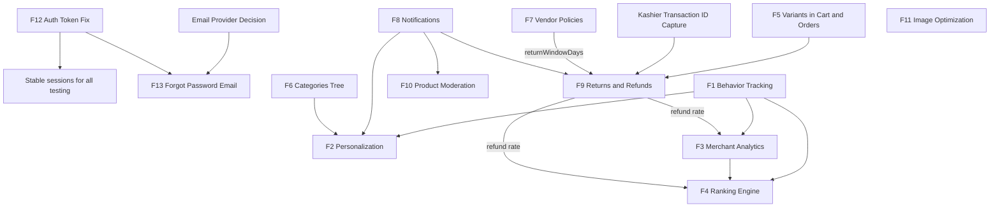

# GoKnary - Change Request Technical Audit / Gap Analysis

> Scope: ANALYSIS ONLY. No code, schema, migration, dependency, or configuration was changed while producing this report.
> Source of truth: the current repository (`backend/prisma/schema.prisma`, `backend/src/**`, `frontend/src/**`).
> Date: 2026-10-05

---

## 1. Executive Summary

GoKnary is a multi-vendor marketplace built on **Express + TypeScript + Prisma (MySQL)** for the backend and **React 18 (CRA) + Redux Toolkit + Tailwind + i18next** for the frontend. The admin and vendor dashboards are part of the same frontend app. Payments use **Kashier** (V3 sessions + webhook) and COD. Messaging uses **Twilio WhatsApp** only.

Key conclusions:

- **No feature in the change request is fully implemented.** Most have a usable foundation that can be extended rather than rewritten.
- **Strong reusable foundations:** `ProductVariant` table, `Category.parentId` self-relation, `Notification` model and REST API with a storefront bell, `RefundRequest` workflow with vendor/admin steps, `ProductStatus` moderation states, `SearchLog`, vendor analytics endpoint, refresh-token rotation with blacklist, multer upload pipeline.
- **Platform-level gaps that affect several features:**
  1. There is **no background job infrastructure** (no cron/queue). Aggregations (analytics, ranking scores) must be computed on request or through a lightweight in-process scheduler.
  2. There is **no email provider**. `backend/src/lib/email.ts` is a deprecated no-op stub, and `nodemailer` is present only as `@types/nodemailer`. Requirement 13 ("use the existing email provider") cannot be met as stated. **A decision is required.**
  3. **No Kashier transaction identifier is persisted** (no `Payment` model, no transaction field on `Order`). Automatic refunds through the Kashier refund API are impossible for historical orders and need a schema addition before they can work for new ones.
  4. **Variants are stored but not sold.** Cart, order creation, stock decrement and stock restore all ignore `variantId`.
  5. **Product listing sorts in memory.** It loads all matching rows and paginates in JS, which does not scale for a ranking engine.

Status distribution across the 13 requested features:

| Status | Count |
|---|---|
| EXISTS | 0 |
| PARTIALLY_EXISTS | 8 |
| NOT_EXISTS | 3 |
| EXISTS_BUT_NEEDS_FIX | 2 |

Recommended first item: **Auth / Token fix (Feature 12)**. It needs no DB change, has low risk, affects every logged-in user, and stabilizes testing for all later work.

---

## 2. Current System Map

### 2.1 Backend (`backend/`)

| Area | Files |
|---|---|
| Entry / middleware stack | `backend/src/server.ts` (helmet, CORS, JSON with rawBody, static `/uploads` + `/api/uploads`, global rate limiter 100 req / 15 min on `/api/`, route mounting) |
| Auth middleware | `backend/src/middleware/auth.ts` (`authenticate`, `authorize`, `requirePermission`) |
| Upload middleware | `backend/src/middleware/upload.ts` (multer diskStorage to `UPLOAD_DIR`, JPEG/PNG/WebP, 10 MB, 10 files) |
| JWT | `backend/src/lib/jwt.ts` (access `JWT_EXPIRES_IN` default 15m, refresh `JWT_REFRESH_EXPIRES_IN` default 7d, payload `{id,email,role}`) |
| Permissions | `backend/src/lib/permissions.ts` (CRUD x 15 resources), `backend/src/controllers/roles.ts` |
| Vendor earnings | `backend/src/lib/vendor-earnings.ts` (`isOrderFinanciallyConfirmed`, `settleOrderOnDelivery`) |
| Email (stub) | `backend/src/lib/email.ts` (deprecated no-op), `backend/src/lib/wpsender.ts` (deprecated) |
| OTP helpers (unused) | `backend/src/lib/otp.ts` |
| WhatsApp | `backend/src/services/whatsapp.service.ts`, `backend/src/controllers/whatsapp.ts` |
| Kashier | `backend/src/services/kashier.service.js`, `backend/src/controllers/payment.controller.js`, `backend/src/routes/payment.js` |
| Auth | `backend/src/controllers/auth.ts`, `backend/src/routes/auth.ts` |
| Products (public) | `backend/src/controllers/products.ts` (listing, search, scoring, search logging, reviews), `backend/src/controllers/products-enhancements.ts` (related, recent) |
| Products (vendor) | `backend/src/controllers/vendor-products.ts` (CRUD, import, variant CRUD) |
| Products (admin) | `backend/src/controllers/admin.ts` (`getPendingAdminProducts`, `updateProductStatus`, `createPlatformProduct`, `getSearchAnalytics`, `getDashboardStats`, orders, users, coupons) |
| Categories | `backend/src/controllers/categories.ts`, `backend/src/controllers/admin-categories.ts` |
| Home | `backend/src/controllers/home.ts` (banners + `HomeSection` types `top_deals`, `trending`, `best_sellers`, `recommended`) |
| Cart / Orders | `backend/src/controllers/cart.ts`, `backend/src/controllers/orders.ts`, `backend/src/controllers/vendor-orders.ts` |
| Refunds | `backend/src/controllers/refunds.ts`, `backend/src/routes/refunds.ts` |
| Payouts / wallet | `backend/src/controllers/payouts.ts`, `backend/src/controllers/admin-vendors.ts` (settle) |
| Vendor | `backend/src/controllers/vendor.ts` (`/vendor/me`, apply), `backend/src/controllers/vendors.ts` (public storefront) |
| Analytics | `backend/src/controllers/vendor-analytics.ts`, `admin.ts#getDashboardStats`, `admin.ts#getSearchAnalytics` |
| Notifications | `backend/src/controllers/notifications.ts`, `backend/src/routes/notifications.ts` |
| Reviews | `backend/src/controllers/reviews.ts` + review endpoints in `products.ts` |
| Other | `tickets.ts`, `coupons.ts`, `admin-coupons.ts`, `shipping.ts`, `settings.ts`, `announcements.ts`, `admin-banners.ts`, `admin-brands.ts`, `wishlist.ts`, `compare.ts`, `addresses.ts`, `upload.ts` |
| Schema / migrations | `backend/prisma/schema.prisma` (MySQL), 9 migrations in `backend/prisma/migrations/` |

### 2.2 Key data model (from `schema.prisma`)

- `User` (role enum CUSTOMER/VENDOR/STAFF/ADMIN, `walletBalance`, OTP and reset columns, `customRoleId`)
- `Vendor` (storeName/Ar, slug, description/Ar, logo, banner, rating, totalReviews, status, commissionRate, balance, pendingBalance, withdrawnAmount). **No policy fields.**
- `Category` (`parentId` self-relation `CategoryChildren`, `orderIndex`, image). **No depth limit in DB.**
- `Product` (price, discountPrice, discountType, discountValue, stock, images as JSON text, status, featured, hasVariants, ratingAvg, ratingCount, lowStockThreshold)
- `ProductVariant` (sku, name/Ar, price, discountPrice, stock, image, `attributes` free-form text, isDefault, status)
- `CartItem` (userId or sessionId, productId, `variantId?`, quantity)
- `Order` (one per vendor, `paymentMethod` and `paymentStatus` as strings, couponCode, discountAmount, addressJson). **No payment transaction ID.**
- `OrderItem` (`variantId?`, price snapshot, `variantInfo`)
- `RefundRequest` (one per `orderItemId` unique, reason, amount, status PENDING/VENDOR_APPROVED/VENDOR_REJECTED/ADMIN_APPROVED/ADMIN_REJECTED, vendorNotes, adminNotes)
- `Notification` (userId, title, message, read, type)
- `RefreshTokenBlacklist` (tokenHash unique, expiresAt)
- `SearchLog` (query, results, userId?)
- `Setting` and `PlatformSetting` (key/value)
- `HomeSection` (type, configJson, orderIndex, status), `Banner` (HERO/PROMO/CATEGORY)

### 2.3 Frontend (`frontend/src/`)

| Area | Files |
|---|---|
| Routing | `App.tsx`, `pages/admin/AdminDashboard.tsx`, `pages/vendor/VendorDashboard.tsx`, `pages/AccountPage.tsx` |
| HTTP client | `lib/api.ts` (axios instance, 401 refresh interceptor with queue) |
| State | `store/slices/authSlice.ts`, `cartSlice.ts`, `categorySlice.ts`, `homeSlice.ts`, `productSlice.ts` |
| Storefront | `pages/HomePage.tsx`, `ProductPage.tsx`, `CategoryPage.tsx`, `ShopPage.tsx`, `SearchPage.tsx`, `StorePage.tsx`, `CartPage.tsx`, `CheckoutPage.tsx`, `PaymentSuccess.jsx` |
| Layout | `components/layout/Header.tsx`, `components/layout/NotificationBadge.tsx`, `components/common/MegaMenu.tsx`, `components/common/MobileDrawer.tsx`, `components/category/CategoryCard.tsx` |
| Account | `pages/account/OrderDetailsPage.tsx`, `pages/account/RefundsPage.tsx`, `pages/account/TicketsPage.tsx` |
| Auth | `pages/LoginPage.tsx`, `RegisterPage.tsx`, `VerifyEmailPage.tsx`, `ForgotPasswordPage.tsx`, `ResetPasswordPage.tsx`, `LogoutPage.tsx` |
| Vendor | `pages/vendor/VendorDashboard.tsx`, `VendorAnalyticsPage.tsx`, `VendorProductFormPage.tsx`, `VendorRefundsPage.tsx`, `VendorSettingsPage.tsx` |
| Admin | `pages/admin/AdminPendingProductsPage.tsx`, `AdminProductsPage.tsx`, `AdminCategoriesPage.tsx`, `AdminRefundsPage.tsx`, `AdminSearchAnalyticsPage.tsx`, `AdminVendorProductsPage.tsx`, `DashboardComponents.tsx` |
| Uploads | `components/common/ImageUploader.tsx`, `utils/upload.ts`, `utils/image.ts` |

### 2.4 Infrastructure

- Deployment on Coolify with Nixpacks (`frontend/nixpacks.toml`). Backend start runs `prisma migrate deploy && tsx src/server.ts`.
- Uploads are stored on local disk at `UPLOAD_DIR=/app/uploads` with a persistent volume.
- No cron, queue, socket.io, Redis, or image processing library.

---

## 3. Feature Gap Analysis

| # | Feature | Current Status | Existing Implementation | Missing Parts | DB Change | Backend Change | Frontend Change | Admin Change | External Integration | Risk |
|---|---|---|---|---|---|---|---|---|---|---|
| 1 | Customer Behavior Tracking (logged-in only) | PARTIALLY_EXISTS | `SearchLog` with optional userId; `searchLog.create` in `products.ts` | Product view, add-to-cart, wishlist, purchase events; event table; ingestion API; retention | Yes (new `UserEvent` table) | Yes | Yes (view/click hooks) | Optional (event insights) | NOT_REQUIRED | MEDIUM |
| 2 | Personalization & Recommendations (first-party, admin/vendor-approved discount suggestions) | NOT_EXISTS | Same-category `similarProducts` / related products by rating; `recommended` home section = `featured` | Per-user recommendations, recently viewed, discount suggestion entity and approval flow | Yes (`DiscountSuggestion`; reads `UserEvent`) | Yes | Yes | Yes (approve suggestions) | NOT_REQUIRED | HIGH |
| 3 | Merchant Analytics & Intelligence | PARTIALLY_EXISTS | `vendor-analytics.ts` (sales, orders by status, salesByDay, top products); `VendorDashboard.tsx` charts; `VendorAnalyticsPage.tsx` | Views, conversion, funnel, refund rate, low stock insight, search demand; hardcoded trend % | Optional (depends on #1; optional daily stats table) | Yes | Yes | Optional | NOT_REQUIRED | MEDIUM |
| 4 | Product/Merchant Ranking Engine (configurable weights) | PARTIALLY_EXISTS | Hardcoded search relevance score and sort options in `products.ts`; out-of-stock last | Weighted score, admin weight config, precomputed score, DB-level sorting | Yes (`Product.rankingScore`, weights in `Setting`) | Yes | Minor | Yes (weights UI) | NOT_REQUIRED | HIGH |
| 5 | Advanced Product Variants | EXISTS_BUT_NEEDS_FIX | `ProductVariant`, `CartItem.variantId`, `OrderItem.variantId/variantInfo`, variant CRUD API, selector on `ProductPage.tsx` | Cart/order/stock ignore `variantId`; no structured option/attribute model; inline variants stripped by zod; variant discountType ignored | Optional (attribute tables) | Yes | Yes | Yes | NOT_REQUIRED | HIGH |
| 6 | Unlimited hierarchical categories, Shop by Category, categories under banner | PARTIALLY_EXISTS | `Category.parentId` self-relation; 2-level API, MegaMenu, CategoryCard, Shop by Category (6 items) | Recursive tree API, descendant-inclusive filtering, N-level admin parent select, breadcrumb path, `/categories` route, strip under hero | No (optional `path`/`depth` columns) | Yes | Yes | Yes | NOT_REQUIRED | MEDIUM |
| 7 | Vendor policies (return/shipping/exchange) + storefront preview | NOT_EXISTS | `Vendor` profile edit (`PATCH /vendor/me`), public `StorePage.tsx`; global policies in `Setting` | Policy fields, API, policy display on product/store page, vendor preview route | Yes (additive columns on `Vendor`) | Yes | Yes | Optional (view) | NOT_REQUIRED | LOW |
| 8 | In-app notifications only | PARTIALLY_EXISTS | `Notification` model, `/api/notifications` CRUD, storefront `NotificationBadge.tsx`; 2 triggers in `createOrder` | Triggers for status/refund/moderation/payout/tickets; polling; deep links; dashboard bell (fake today) | Yes (additive `link`, `entityType`, `entityId`) | Yes | Yes | Yes | NOT_REQUIRED | LOW |
| 9 | Returns & Refunds workflow with auto (gateway) and manual refunds | PARTIALLY_EXISTS | `RefundRequest` with vendor + admin steps; wallet credit; vendor balance debit; stock restore on admin approval | New status chain, ITEM_RECEIVED step, stock restore moved to receipt, Kashier refund call, manual refund recording, partial quantity, audit history | Yes (enum extension + new columns + `Order` transaction ID) | Yes | Yes | Yes | REQUIRED (Kashier refund API - existing provider) | VERY HIGH |
| 10 | Product review workflow (DRAFT -> PENDING_REVIEW -> APPROVED -> PUBLISHED / REJECTED) | PARTIALLY_EXISTS | `ProductStatus` DRAFT/PENDING/APPROVED/ACTIVE/REJECTED/INACTIVE; vendor create forced to PENDING; admin approve/reject | Rejection reason persisted and shown; vendor notification; explicit submit-for-review; vendor cannot self-feature; name edit bug | Yes (additive `rejectionReason`, `reviewedAt`, `reviewedBy`) | Yes | Yes | Yes | NOT_REQUIRED | MEDIUM |
| 11 | Image optimization (resize, compression, WebP) | NOT_EXISTS | multer disk storage in `middleware/upload.ts`; `/uploads/<uuid>.<ext>` URLs | Server-side processing pipeline | No | Yes (add `sharp`) | Optional | No | NOT_REQUIRED (library only) | LOW |
| 12 | Auth / token fix (no logout with valid refresh token) | EXISTS_BUT_NEEDS_FIX | Refresh rotation + blacklist; axios 401 interceptor with queue | Correct failure handling, limiter exemption, unique `jti`, idempotent blacklist, cross-tab sync | No | Yes | Yes | No | NOT_REQUIRED | LOW |
| 13 | Forgot Password via existing email provider | PARTIALLY_EXISTS | WhatsApp OTP flow (`forgot-password`/`reset-password`), `ForgotPasswordPage.tsx` | No email provider; plaintext OTP; no reset attempt limit; broken `ResetPasswordPage.tsx`; no session revocation | Optional (reuse existing `passwordResetToken`/`passwordResetExpires`) | Yes | Yes | No | REQUIRED (SMTP provider - decision needed) | MEDIUM |

---

## 4. Detailed Analysis per Feature

### Feature 1 - Customer Behavior Tracking (logged-in users only)

**What exists now**
- `SearchLog` table (`query`, `results`, `userId?`, `createdAt`) written fire-and-forget in `backend/src/controllers/products.ts` (around L305-330); `userId` resolved from an optional JWT.
- `OrderStatusHistory` and `Order`/`OrderItem` give purchase history.
- `WishlistItem` and `CartItem` reflect current intent but not history.
- Frontend: no tracking code except a GA4-style `dataLayer.push` in `pages/PaymentSuccess.jsx` (no container loaded; must not be extended per the Meta/external restriction).

**What is missing**
- Event store for `PRODUCT_VIEW`, `CATEGORY_VIEW`, `ADD_TO_CART`, `REMOVE_FROM_CART`, `WISHLIST_ADD`, `CHECKOUT_START`, `PURCHASE`, `SEARCH`.
- Ingestion endpoint restricted to authenticated users.
- Retention/cleanup policy.

**What can be reused**
- `authenticate` middleware (guarantees logged-in only).
- Fire-and-forget write pattern from search logging.
- `SearchLog` stays as-is for search events.

**Proposed implementation**
- New `UserEvent` table; `POST /api/events` (authenticated, batched, rate-limited) plus server-side emission for cart/wishlist/order events from existing controllers (more reliable than client-side).
- Frontend `useTrackEvent` hook in `ProductPage.tsx` / `CategoryPage.tsx`, sending only when `isAuthenticated`.

**Database impact**: additive table `UserEvent(id, userId, type, productId?, categoryId?, vendorId?, metadata JSON text, createdAt)` with indexes on `(userId, createdAt)`, `(productId, type, createdAt)`.

**API impact**: new `POST /api/events`; optional `GET /api/me/recently-viewed`.

**Frontend impact**: tracking hook; recently viewed strip (also used by Feature 2).

**Admin impact**: optional aggregate views; none mandatory.

**Risks**: table growth (needs retention); write load on product page; privacy statement update.

**Dependencies**: none. Feature 2, 3 and 4 depend on it.

---

### Feature 2 - Personalization & Recommendations

**What exists now**
- `getProductBySlug` returns `similarProducts` (same category, by `ratingAvg`) but the frontend does not render it.
- `getRelatedProducts` in `products-enhancements.ts` (same category, 4 items, no vendor status filter).
- `home.ts` `recommended` section = `featured: true` products, not personalized.

**What is missing**
- Per-user recommendation logic (recently viewed, viewed-together, bought-together, category affinity).
- Discount suggestion entity with approval by admin or vendor.
- Recently viewed UI.

**What can be reused**
- Existing product query shape and filters in `products.ts`.
- `Product.discountType/discountValue/discountPrice` and `frontend/src/utils/discount.ts` to apply an approved suggestion.
- `HomeSection` table to add a `personalized` section type.

**Proposed implementation**
- Rule-based first-party engine (SQL over `UserEvent` + `OrderItem`): category affinity, co-viewed, co-purchased, trending fallback.
- `DiscountSuggestion` generated for products with high views + low conversion or slow stock; vendor or admin approves, which writes the existing discount fields.

**Database impact**: additive `DiscountSuggestion(id, productId, vendorId, suggestedType, suggestedValue, reason, status PENDING/APPROVED/REJECTED, decidedBy, decidedAt, createdAt)`.

**API impact**: `GET /api/recommendations?context=home|product|cart`; `GET/PATCH /api/vendor/discount-suggestions`; `GET/PATCH /api/admin/discount-suggestions`.

**Frontend impact**: "Recommended for you" and "Recently viewed" sections on Home/Product/Cart; render existing `similarProducts`.

**Admin impact**: suggestions queue; vendor dashboard suggestions page.

**Risks**: cold start; query cost without precomputation; must never auto-apply discounts.

**Dependencies**: Feature 1 (data), Feature 8 (notify on new suggestion), Feature 4 (shared scoring signals).

---

### Feature 3 - Merchant Analytics & Intelligence

**What exists now**
- `GET /api/vendor/analytics?period=` (`backend/src/controllers/vendor-analytics.ts`): totalOrders, delivered sales/earnings, pending sales/earnings, ordersByStatus, salesByDay, topProducts.
- `VendorDashboard.tsx`: 7 stat cards (two trend % hardcoded 12.4% / 4.8%), area and bar charts.
- `VendorAnalyticsPage.tsx`: cards and lists; ignores `salesByDay`.
- Admin: `getDashboardStats`, per-vendor stats in `admin-vendors.ts`, `getSearchAnalytics`.

**What is missing**
- Product views, conversion rate, add-to-cart rate, refund rate, repeat customer rate, low stock alerts, search demand related to vendor catalog, period-over-period comparison.
- Bug: dashboard reads `vendorRes.data.storeName` but backend returns `{ vendor }` (`controllers/vendor.ts` ~L105).

**What can be reused**: existing endpoint and charts (extend response, keep old fields); `lowStockThreshold`; `SearchLog`; `RefundRequest`.

**Proposed implementation**: extend the existing endpoint with new keys (backward compatible); compute real comparisons with the previous period; add product-level breakdown endpoint.

**Database impact**: none required beyond Feature 1. Optional `ProductDailyStat` rollup if on-request aggregation becomes slow.

**API impact**: extend `GET /api/vendor/analytics`; new `GET /api/vendor/analytics/products`.

**Frontend impact**: new cards/charts; remove hardcoded trends; fix `/vendor/me` shape.

**Admin impact**: optional platform-wide equivalents.

**Risks**: heavy aggregate queries without rollups; correctness of revenue definitions (shipping included in admin but excluded in vendor numbers today).

**Dependencies**: Feature 1 for view/conversion metrics; Feature 9 for refund metrics.

---

### Feature 4 - Product / Merchant Ranking Engine

**What exists now**
- `getProducts` (`products.ts` L90-346) loads all matching rows, scores search relevance (name prefix 100, name 50, brand 30, category 20, description 10, SKU 5), puts out-of-stock last, then sorts by `sort` param and paginates in memory.
- `featured` is not used in listing. Home `trending`/`best_sellers` are rating-based, not sales-based.
- Vendor `rating`/`totalReviews` only set by seed; no aggregation.

**What is missing**
- Weighted score combining sales, conversion, rating, review count, freshness, stock, vendor quality (refund rate, fulfillment time), featured boost.
- Admin-configurable weights.
- Precomputed score with DB-level ordering and pagination.

**What can be reused**: existing relevance scoring for text match; `Setting` table for weights; `ratingAvg`/`ratingCount`; vendor-analytics aggregations.

**Proposed implementation**
- Store weights as JSON under a `ranking_weights` key in `Setting`.
- Recompute `Product.rankingScore` (and `Vendor.rankingScore`) on relevant events and through a periodic in-process job (no new infra).
- New `sort=recommended` uses `orderBy rankingScore` at DB level; keep the existing sort values unchanged.

**Database impact**: additive `Product.rankingScore Float @default(0)` + index; `Vendor.rankingScore`; optional `salesCount` on Product.

**API impact**: new sort option; `GET/PUT /api/admin/ranking-config`; optional `POST /api/admin/ranking/recompute`.

**Frontend impact**: "Recommended" sort label; home sections switched to real sales/ranking.

**Admin impact**: weights editor with preview.

**Risks**: changing listing order affects SEO/user expectations; in-memory pagination must be replaced carefully to avoid regressions in search relevance.

**Dependencies**: Feature 1 (views/conversion), Feature 9 (refund rate), Feature 3 (shared aggregations).

---

### Feature 5 - Advanced Product Variants

**What exists now**
- `ProductVariant` (sku, price, discountPrice, stock, image, `attributes` text, isDefault, status) and variant CRUD (`vendor-products.ts` L505-680).
- `CartItem.variantId`, `OrderItem.variantId`, `OrderItem.variantInfo` columns exist.
- `ProductPage.tsx` variant selector updates price/stock/image.

**What is missing / broken**
- `ProductPage.tsx` calls `addToCart({ productId, quantity })` without variant; `cartSlice.ts` and `addToCartSchema` (`cart.ts` L13-16) have no `variantId`.
- `createOrder` item schema (`orders.ts` L15-19) has no variant; stock checked and decremented on `Product.stock`; `OrderItem` created without `variantId`.
- Stock restore (customer cancel, vendor cancel, Kashier failure, refund approval) uses product stock only; admin cancel restores nothing.
- Inline `variants` on product create are stripped by zod (not in schema).
- `createProductVariant` ignores `discountType`/`discountValue`.
- Attributes are free text; no structured option groups (e.g. Color x Size matrix).

**What can be reused**: all existing columns and CRUD endpoints; selector UI; discount utils.

**Proposed implementation**
- Accept optional `variantId` in cart and order schemas (backward compatible: absent = product-level).
- Price and stock from the variant when present; decrement/restore the variant stock in the same transaction.
- Structured attributes: keep `attributes` as JSON with an agreed shape `{ "Color": "Red", "Size": "M" }`; optional `ProductOption`/`ProductOptionValue` tables only if a matrix builder is required.

**Database impact**: none required. Optional option tables (additive).

**API impact**: update `POST /api/cart/items`, `POST /api/orders`; extend product create schema with `variants`.

**Frontend impact**: cart slice/thunks, cart and checkout item display (variant label), vendor variant builder.

**Admin impact**: variant visibility in admin product and order views.

**Risks**: stock semantics change for products with variants (which stock is authoritative); existing carts without variantId for `hasVariants` products; order history display.

**Dependencies**: blocks correct partial returns and stock restore in Feature 9.

---

### Feature 6 - Unlimited Hierarchical Categories, Shop by Category, Categories under Banner

**What exists now**
- `Category.parentId` self-relation; no DB depth limit.
- `GET /api/categories` returns top-level with one level of children; `GET /api/categories/:slug` returns parent, children, siblings.
- `MegaMenu.tsx` and `MobileDrawer.tsx` render 2 levels (MobileDrawer filters a flat list by `parentId` while receiving a tree, so children likely never show).
- `HomePage.tsx` "Shop by Category" shows first 6 top-level categories; "View All" links to a non-existent `/categories` route.
- `AdminCategoriesPage.tsx` parent dropdown offers top-level only; `image` and `orderIndex` are sent as `''`/`0` on every save (data loss on edit).
- Product filter is exact `categoryId IN [...]`; parent category pages do not include children products.

**What is missing**: recursive tree, descendant inclusion, full breadcrumb, N-level admin selector with cycle prevention, image/order inputs, categories page, category strip under hero banner.

**What can be reused**: existing model, endpoints, `CategoryCard`, `Banner` type `CATEGORY` (already in enum).

**Proposed implementation**
- Build the tree in memory from one flat query (category count is small); return full tree from `GET /api/categories` with a `depth`/`tree=full` parameter to keep the current response for existing callers.
- Product filter expands to all descendant IDs.
- Admin: tree-select parent, block selecting self/descendant, add image and order inputs.
- Home: horizontal category strip under the hero; new `/categories` page.

**Database impact**: none required. Optional `path`/`depth` columns only if performance requires.

**API impact**: extend `GET /api/categories`, `GET /api/categories/:slug` (breadcrumb `ancestors`), product filter behavior.

**Frontend impact**: recursive MegaMenu/MobileDrawer, breadcrumb, `/categories` route, home strip, recursive vendor product category select.

**Admin impact**: tree management.

**Risks**: including descendants changes counts on existing category pages (intended); cycles if parent validation is missing.

**Dependencies**: none. Improves Feature 2 (category affinity) and Feature 4.

---

### Feature 7 - Vendor Policies + Storefront Preview

**What exists now**
- `VendorSettingsPage.tsx` edits storeName, description, logo, banner through `PATCH /api/vendor/me`.
- `StorePage.tsx` public storefront; global policies (terms/privacy/cookies) in `Setting` via `GET /api/settings/policies/:key`.
- `ProductPage.tsx` shows hardcoded "EGP 500" and "14-day" return text.
- `VendorLockdown` redirects logged-in vendors away from public routes, so vendors cannot view `/store/:slug`.

**What is missing**: return/shipping/exchange policy fields (EN/AR), display on store and product pages, preview inside the vendor dashboard.

**What can be reused**: `PATCH /vendor/me`, `GET /vendors/:slug`, `StorePage` components, `ImageUploader`.

**Proposed implementation**
- Additive nullable text columns on `Vendor`.
- Vendor dashboard route `/vendor/store-preview` rendering the store components inside the dashboard (avoids changing `VendorLockdown`).
- Product page reads vendor policies, falls back to platform defaults.

**Database impact**: `Vendor.returnPolicy`, `returnPolicyAr`, `shippingPolicy`, `shippingPolicyAr`, `exchangePolicy`, `exchangePolicyAr`, optional `returnWindowDays Int?` (all nullable, additive).

**API impact**: extend `PATCH /vendor/me` zod schema and `GET /vendors/:slug` / product detail vendor include.

**Frontend impact**: settings form section, store "Policies" tab, product page policy block, preview route; also fix the `/vendor/me` response shape bug.

**Admin impact**: read-only view in vendor details (optional moderation).

**Risks**: low. `returnWindowDays` would become an input to Feature 9 validation.

**Dependencies**: Feature 9 can use `returnWindowDays`.

---

### Feature 8 - In-App Notifications Only

**What exists now**
- `Notification` model; `GET /api/notifications` (latest 50 + unreadCount), mark read, mark all read, delete (`controllers/notifications.ts`, which creates its own `new PrismaClient()` instead of `lib/prisma.ts`).
- Storefront bell `components/layout/NotificationBadge.tsx` fetched once on login; no polling.
- Dashboard bell in `pages/admin/DashboardComponents.tsx` is decorative.
- Triggers: only vendor "New Order" and admin notifications inside `createOrder`.

**What is missing**: triggers for order status changes, refunds (every transition), product moderation, payouts, tickets, discount suggestions; deep links; polling; working dashboard bell; a single helper to create notifications.

**What can be reused**: entire model/API/bell component.

**Proposed implementation**
- `lib/notify.ts` helper (`notify(userId, {title, message, type, link})`) called from existing controllers.
- Polling every 30-60 s with visibility check (no socket/push per constraints).
- Reuse `NotificationBadge` in admin and vendor dashboards.
- Bilingual content: store a `key` + params or both languages.

**Database impact**: additive nullable `link`, `entityType`, `entityId`, optional `titleAr`, `messageAr`; index `(userId, read)`.

**API impact**: optional `GET /api/notifications/unread-count` (lightweight for polling).

**Frontend impact**: polling, deep link navigation, dashboard bell.

**Admin impact**: dashboard bell for admins/staff.

**Risks**: polling load (mitigated by a light count endpoint); notification spam to all admins.

**Dependencies**: used by Features 2, 9, 10.

---

### Feature 9 - Returns & Refunds Workflow

**What exists now** (`backend/src/controllers/refunds.ts`)
- One `RefundRequest` per `OrderItem` (unique), full quantity only; amount = `(discountPrice || price) x quantity` (ignores coupon share and shipping).
- Customer creates from a DELIVERED order (no return window). Vendor approves/rejects from PENDING. Admin can act from PENDING/VENDOR_APPROVED/VENDOR_REJECTED.
- On ADMIN_APPROVED, in one transaction: credit `User.walletBalance`, debit `Vendor.balance` (can go negative), restore `Product.stock` (immediately, before the item is received).
- No order status change, no notifications, no history table.
- `returnOrder` in `orders.ts` (L538-585) sets an order to REFUNDED with no money or stock movement (parallel, inconsistent path).
- Kashier: no refund call; no transaction ID stored; webhook only reads `merchantOrderId`/order reference.
- Frontend: `OrderDetailsPage.tsx` form (reason only), `RefundsPage.tsx`, `VendorRefundsPage.tsx`, `AdminRefundsPage.tsx`.

**What is missing**
- Target states: REQUESTED, UNDER_REVIEW, APPROVED, ITEM_RECEIVED, REFUND_PROCESSING, REFUNDED, REJECTED.
- Stock restore only at ITEM_RECEIVED (variant-aware).
- Automatic refund through the Kashier refund API for KASHIER-paid orders; manual refund (wallet, cash, bank transfer, Vodafone Cash) with reference recording.
- Partial quantity, return window, reason categories, images, status history.

**What can be reused**: the model, UI pages, transactional pattern, wallet credit logic (as one manual method), vendor balance adjustment, `ImageUploader` for evidence photos.

**Proposed implementation**
- Extend the enum additively (keep old values for existing rows) and map legacy values in API responses: PENDING -> REQUESTED, VENDOR_APPROVED -> UNDER_REVIEW, ADMIN_APPROVED -> REFUNDED, VENDOR_REJECTED/ADMIN_REJECTED -> REJECTED.
- Add a state-machine guard function and `RefundStatusHistory`.
- Persist Kashier transaction identifiers from the webhook on new orders; refund via Kashier API when available, otherwise fall back to manual.
- Move stock restoration from admin approval to ITEM_RECEIVED.
- Deprecate `PATCH /orders/:id/return` (keep route but delegate to the refund flow).

**Database impact**
- `RefundStatus` enum: add REQUESTED, UNDER_REVIEW, APPROVED, ITEM_RECEIVED, REFUND_PROCESSING, REFUNDED, REJECTED (additive `ALTER TABLE ... MODIFY ENUM`).
- `RefundRequest`: `quantity Int @default(<item qty>)`, `refundMethod String?` (GATEWAY/WALLET/MANUAL), `gatewayRefundId String?`, `manualReference String?`, `images Text?`, `receivedAt`, `refundedAt`, `processedBy`.
- New `RefundStatusHistory(id, refundRequestId, fromStatus, toStatus, actorId, notes, createdAt)`.
- `Order`: `paymentTransactionId String?`, `paymentProviderOrderId String?`, `paidAt DateTime?`.
- Reconsider `ON DELETE CASCADE` from orders/users to refunds (history loss) - flag only.

**API impact**: `POST /refunds` (add quantity, images); `PATCH /refunds/:id/review`, `/approve`, `/reject`, `/receive`, `/process`, `/complete-manual`; keep `/vendor` and `/admin` endpoints as compatibility wrappers.

**Frontend impact**: customer form (quantity, reason, images), status timeline; vendor/admin action buttons per state; manual refund modal.

**Admin impact**: queue by state, gateway refund trigger, manual refund recording, reconciliation view.

**Risks**: enum migration on production data; double refund (gateway + wallet) without idempotency; Kashier API capabilities (partial refund support, required IDs) must be verified with the merchant account; historical orders have no transaction ID, so they can only be refunded manually.

**Dependencies**: Feature 5 (variant stock restore), Feature 8 (notifications), Feature 7 (return window), Kashier transaction ID capture (prerequisite).

---

### Feature 10 - Product Review (Moderation) Workflow

**What exists now**
- `ProductStatus`: DRAFT, PENDING, ACTIVE, APPROVED, INACTIVE, REJECTED. Public listing shows ACTIVE or APPROVED.
- Vendor create with ACTIVE/APPROVED is forced to PENDING (`vendor-products.ts` L265-271); import sets PENDING for vendors.
- `GET /api/admin/products/pending`, `PATCH /api/admin/products/:id/status` (`admin.ts` L667-710): `notes` accepted but not saved.
- `AdminPendingProductsPage.tsx`: approve, reject via `window.confirm` (no reason), delete; eye icon goes to vendor product list (no single preview).
- Vendor edits of an ACTIVE product do not go back to review (this matches "no re-review after publishing").

**What is missing / broken**
- Rejection reason storage and display to vendor; vendor notification.
- Explicit "Submit for review" action from DRAFT; resubmission after REJECTED.
- Clear mapping: requested PENDING_REVIEW = existing PENDING; PUBLISHED = existing ACTIVE; APPROVED exists (decide whether APPROVED auto-publishes or vendor publishes).
- Vendors can set `featured` on create/update (should be admin-only).
- Bug: `updateVendorProduct` never writes `name` (only regenerates the slug).
- Admin single-product preview.

**What can be reused**: enum values (no rename needed), endpoints, pending page.

**Proposed implementation**: keep enum, add a transition guard; persist reason; `POST /vendor/products/:id/submit`; strip `featured` for vendors; notify on decisions.

**Database impact**: additive `Product.rejectionReason Text?`, `reviewedAt DateTime?`, `reviewedBy String?`, `submittedAt DateTime?`.

**API impact**: update `PATCH /admin/products/:id/status` (require reason when REJECTED); new submit endpoint; include reason in vendor product GET.

**Frontend impact**: reject modal with reason; vendor product list shows status + reason; submit/resubmit buttons; admin preview.

**Admin impact**: preview drawer, reason modal.

**Risks**: ACTIVE vs APPROVED ambiguity in existing data; must not unpublish currently live products.

**Dependencies**: Feature 8.

---

### Feature 11 - Image Optimization

**What exists now**
- `middleware/upload.ts`: multer diskStorage, UUID filename + original extension, JPEG/PNG/WebP, 10 MB, 10 files.
- `controllers/upload.ts` returns `/uploads/<file>`; frontend `utils/image.ts#getImageUrl` builds absolute URLs; images stored as JSON text in `Product.images`.
- `ImageUploader.tsx`: no client-side compression.

**What is missing**: resize (max dimension), compression, WebP output, optional thumbnails.

**What can be reused**: same storage directory, same URL format, same response shape `{ urls }`.

**Proposed implementation**
- Add `sharp` (library dependency, not an external service); after multer writes the file, convert to WebP with max width (e.g. 1600 px) and quality ~80, save as `<uuid>.webp`, delete the original, return the new URL.
- Optional thumbnail variant `<uuid>_thumb.webp`.
- Existing images remain untouched; optional one-off backfill script later.

**Database impact**: none.

**API impact**: none (same endpoint and shape).

**Frontend impact**: optional `srcset` for thumbnails; optional client-side pre-compression.

**Admin impact**: none.

**Risks**: `sharp` native binaries on Nixpacks/Coolify build; CPU/memory per upload; GIF/animated images not allowed today (no impact).

**Dependencies**: none.

---

### Feature 12 - Auth / Token Fix

**What exists now**
- Access token 15m default, refresh 7d default (`lib/jwt.ts`), payload `{id, email, role}` with no `jti`.
- `POST /api/auth/refresh` rotates and blacklists the old token (`auth.ts` L428-482) and returns `{accessToken, refreshToken}` (matches frontend).
- Middleware returns 401 on expiry (correct for the interceptor).
- `frontend/src/lib/api.ts` interceptor: queue while refreshing; on any refresh failure clears tokens and hard-redirects to `/login`.

**Root causes of unwanted logouts**
1. Interceptor catch (L98-104) logs out on 429/5xx/network errors, not only on 401 from the refresh call.
2. Global limiter (`server.ts` L144-148, 100 req / 15 min per IP) covers `/api/auth/refresh`; busy dashboards exceed it; `trust proxy = 1` may group users behind one IP.
3. Cross-tab race: two tabs refresh the same token; the loser gets 401 (blacklisted) or 500 (P2002 on unique `tokenHash`) and clears the shared localStorage, logging out all tabs.
4. Deterministic tokens: no `jti`, so two refresh tokens issued in the same second are identical; the "new" token can equal the one just blacklisted.
5. Secondary: `api.defaults.headers.common.Authorization` is left set after logout; logout does not send the refresh token (no revocation); change/reset password does not revoke sessions.

**What can be reused**: entire rotation/blacklist design.

**Proposed implementation**
- Add `jti: randomUUID()` to refresh (and access) tokens.
- Idempotent blacklist insert (upsert / catch P2002) with a short grace window for just-rotated tokens.
- Separate, higher limiter for `/api/auth/refresh` (or exempt) and review `trust proxy`.
- Interceptor: log out only when refresh returns 401/403; on other errors reject the request but keep the session; before clearing, re-read localStorage and retry if another tab already rotated; listen to the `storage` event.
- Logout sends `refreshToken`; delete default Authorization header.

**Database impact**: none.

**API impact**: none in contract; behavior only.

**Frontend impact**: `lib/api.ts`, `store/slices/authSlice.ts`.

**Admin impact**: none.

**Risks**: low; existing tokens remain valid (no format break because `jti` is additive).

**Dependencies**: none. Recommended first.

---

### Feature 13 - Forgot Password (Email)

**What exists now**
- `POST /api/auth/forgot-password { phone }` -> 6-digit OTP via Twilio WhatsApp (`sendResetOTP`), stored plaintext in `User.passwordResetOtp` with expiry.
- `POST /api/auth/reset-password { phone, otp, newPassword }`; no attempt limit (brute-force risk); OTP from `Math.random`.
- `ForgotPasswordPage.tsx` implements this phone flow.
- `ResetPasswordPage.tsx` posts `{ token, newPassword }`, which the backend rejects (dead legacy flow).
- `User.passwordResetToken` / `passwordResetExpires` columns already exist (unused).
- **No email provider**: `lib/email.ts` is a no-op; `nodemailer` not installed; no SMTP env vars.

**What is missing**: email delivery; hashed single-use token link; attempt limits; session revocation after reset.

**What can be reused**: existing User columns, route paths, `ResetPasswordPage.tsx` (already token-based UI), `bcrypt` helpers in `lib/otp.ts`.

**Proposed implementation**
- **Decision required:** the requirement says "existing email provider" but none exists. Least-disruptive option within the current stack: SMTP via `nodemailer` using the company mailbox/domain SMTP credentials (no new SaaS dependency).
- Accept `{ email }` or `{ phone }` on `forgot-password` (keep phone path for backward compatibility); generate a random 32-byte token, store its SHA-256 hash in `passwordResetToken`, expiry 30-60 minutes; email link `/reset-password?token=...`.
- `reset-password` accepts `{ token, newPassword }` or legacy `{ phone, otp, newPassword }`; invalidate token; revoke refresh tokens (via a `passwordChangedAt`/token version check).
- Add attempt limiting and a dedicated rate limiter.

**Database impact**: none required (reuse columns). Optional `User.passwordChangedAt` for session revocation (additive).

**API impact**: extend the two existing endpoints (backward compatible).

**Frontend impact**: email option on `ForgotPasswordPage.tsx`; `ResetPasswordPage.tsx` becomes functional.

**Admin impact**: none.

**Risks**: email deliverability (SPF/DKIM); users without verified email (registration verifies phone, not email; `emailVerified` is false by default).

**Dependencies**: email provider decision; Feature 12 (session revocation design).

---

## 5. Database Changes Required (proposed only - NOT executed)

All proposals are **additive** (new nullable columns, new tables, new enum values). No column is dropped or renamed. Existing production data is preserved.

| # | Change | Type | Feature | Risk |
|---|---|---|---|---|
| D1 | `UserEvent` table + indexes | New table | 1, 2, 3, 4 | LOW (growth needs retention) |
| D2 | `DiscountSuggestion` table | New table | 2 | LOW |
| D3 | `ProductDailyStat` rollup (optional) | New table | 3, 4 | LOW |
| D4 | `Product.rankingScore`, `Product.salesCount`, `Vendor.rankingScore` + index | New columns | 4 | LOW (needs backfill job) |
| D5 | Ranking weights under `Setting.key = 'ranking_weights'` | Data row only | 4 | LOW |
| D6 | `ProductOption` / `ProductOptionValue` (optional) | New tables | 5 | MEDIUM |
| D7 | `Category.path`, `Category.depth` (optional) | New columns | 6 | MEDIUM (backfill) |
| D8 | `Vendor.returnPolicy/Ar`, `shippingPolicy/Ar`, `exchangePolicy/Ar`, `returnWindowDays` | New nullable columns | 7 | LOW |
| D9 | `Notification.link`, `entityType`, `entityId`, `titleAr`, `messageAr` + index `(userId, read)` | New nullable columns | 8 | LOW |
| D10 | `RefundStatus` enum: add REQUESTED, UNDER_REVIEW, APPROVED, ITEM_RECEIVED, REFUND_PROCESSING, REFUNDED, REJECTED | Enum extension | 9 | **HIGH** |
| D11 | `RefundRequest.quantity`, `refundMethod`, `gatewayRefundId`, `manualReference`, `images`, `receivedAt`, `refundedAt`, `processedBy` | New columns | 9 | MEDIUM (`quantity` backfill from OrderItem) |
| D12 | `RefundStatusHistory` table | New table | 9 | LOW |
| D13 | `Order.paymentTransactionId`, `paymentProviderOrderId`, `paidAt` | New nullable columns | 9 | LOW |
| D14 | `Product.rejectionReason`, `reviewedAt`, `reviewedBy`, `submittedAt` | New nullable columns | 10 | LOW |
| D15 | `User.passwordChangedAt` (optional) | New nullable column | 12, 13 | LOW |

**Risky migrations to flag**
- **D10 (enum change on MySQL)**: `ALTER TABLE refund_requests MODIFY status ENUM(...)` rewrites the table. Only add values; never remove or rename legacy values in the same release. Map legacy values in code.
- **Any change to `ProductStatus`**: not proposed. Requested names (PENDING_REVIEW, PUBLISHED) should be mapped to existing PENDING/ACTIVE to avoid an enum rewrite on `products`.
- **Backfills (D4, D7, D11)**: run as separate idempotent scripts after the schema migration, not inside it.
- **Existing drift**: migration `20260425160619_go_kanaryy` (unique `users.phone`, mass FK creation) and the hand-written idempotent `20260525160426_add_marketplace_features` indicate past manual production changes. Run `prisma migrate status` / diff against a production snapshot before any new migration.
- **Cascade deletes**: `RefundRequest` cascades on order/user delete (history loss). Changing to RESTRICT is a behavior change; flag only.
- **Schema inconsistency**: `WishlistItem.userId` required but relation declared optional (`User?`); `CartItem.userId`, `CompareItem.userId`, `SearchLog.userId`, `RefundRequest.vendorId`, `Commission` have no FK. Do not "fix" these in the same migration as new features.
- Production start runs `prisma migrate deploy` automatically; a failed migration blocks the backend from starting.

---

## 6. APIs

### 6.1 Existing endpoints reusable as-is or with extension

| Endpoint | Reuse for |
|---|---|
| `GET /api/products` | Ranking (`sort=recommended`), descendant category filter |
| `GET /api/products/:slug`, `/:slug/related`, `/recent` | Recommendations, recently viewed fallback |
| `GET /api/home/sections` | Personalized section, real best sellers |
| `GET /api/categories`, `/:slug` | Full tree, ancestors |
| `GET/POST/PATCH/DELETE /api/admin/categories` | N-level parent management |
| `GET/POST/PATCH/DELETE /api/vendor/products[/:id]`, `/:productId/variants` | Variants, submit for review |
| `POST /api/cart/items`, `GET /api/cart` | Variant-aware cart |
| `POST /api/orders` | Variant-aware orders |
| `GET /api/vendor/analytics` | Extended merchant analytics |
| `GET /api/admin/products/pending`, `PATCH /api/admin/products/:id/status` | Moderation with reason |
| `GET/PATCH/DELETE /api/notifications` | In-app notifications |
| `POST /api/refunds`, `GET /api/refunds`, `PATCH /api/refunds/:id/vendor`, `/admin` | Returns workflow (compatibility wrappers) |
| `POST /api/payment/webhook` | Capture transaction IDs |
| `GET/PATCH /api/vendor/me`, `GET /api/vendors/:slug` | Vendor policies, preview |
| `POST /api/upload` | Image optimization (same contract) |
| `POST /api/auth/refresh`, `/logout`, `/forgot-password`, `/reset-password` | Auth fix, email reset |
| `GET /api/admin/search-analytics`, `GET/PUT /api/settings` | Analytics, ranking weights storage |

### 6.2 Proposed new / updated endpoints

| Method | Path | Feature | Notes |
|---|---|---|---|
| POST | `/api/events` | 1 | Authenticated only, batched |
| GET | `/api/me/recently-viewed` | 1, 2 | Authenticated |
| GET | `/api/recommendations?context=` | 2 | Authenticated; fallback to trending |
| GET/PATCH | `/api/vendor/discount-suggestions[/:id]` | 2 | Vendor approval |
| GET/PATCH | `/api/admin/discount-suggestions[/:id]` | 2 | Admin approval |
| GET | `/api/vendor/analytics/products` | 3 | Product-level metrics |
| GET/PUT | `/api/admin/ranking-config` | 4 | Weights |
| POST | `/api/admin/ranking/recompute` | 4 | Manual recompute |
| UPDATE | `POST /api/cart/items`, `POST /api/orders` | 5 | Optional `variantId` |
| UPDATE | `GET /api/categories?tree=full` | 6 | Recursive tree |
| UPDATE | `PATCH /api/vendor/me` | 7 | Policy fields |
| GET | `/api/notifications/unread-count` | 8 | Polling |
| PATCH | `/api/refunds/:id/review`, `/approve`, `/reject`, `/receive`, `/process`, `/complete-manual` | 9 | State machine |
| GET | `/api/refunds/:id/history` | 9 | Timeline |
| POST | `/api/vendor/products/:id/submit` | 10 | DRAFT/REJECTED -> PENDING |
| UPDATE | `PATCH /api/admin/products/:id/status` | 10 | Persist `rejectionReason` |
| UPDATE | `POST /api/auth/forgot-password`, `/reset-password` | 13 | Email + token, legacy phone kept |

---

## 7. External Integrations Assessment

| Integration | Status | Notes |
|---|---|---|
| Kashier refund API | REQUIRED (Feature 9 auto refunds) | Existing payment provider; no new provider. Requires capturing Kashier transaction/order identifiers in the webhook first. Exact endpoint, partial-refund support and credentials must be confirmed with the Kashier merchant account. |
| Email delivery (SMTP via nodemailer) | REQUIRED (Feature 13) | No existing email provider in the code. Decision needed: use company domain SMTP (preferred, no new SaaS). |
| `sharp` (npm library) | REQUIRED (Feature 11) | Local library, not an external service. Storage provider unchanged. |
| Meta Pixel / Meta CAPI | NOT_REQUIRED | Explicitly excluded. |
| External recommendation engines / external AI | NOT_REQUIRED | First-party SQL-based logic only. |
| Firebase / OneSignal / push notifications | NOT_REQUIRED | In-app notifications with polling. |
| SMS / WhatsApp (Twilio) for new features | NOT_REQUIRED | Existing WhatsApp OTP/order messages stay untouched. |
| Google Analytics / GTM | NOT_REQUIRED | Tracking is first-party in DB. |
| Cloud storage (S3 etc.) | NOT_REQUIRED | Keep local disk + Coolify volume. |
| Redis / queue | OPTIONAL | Not needed initially; in-process scheduler is enough for ranking recompute. |

---

## 8. Dependency Map

Independent items: F6, F7, F11, F12 (can start anytime). F11 has no dependants.

---

## 9. Suggested Implementation Phases

**Phase 1 - Fixes and stability (no or minimal DB change)**
- F12 Auth/token fix.
- F5 variants in cart/orders/stock (no schema change).
- F10 moderation: persist reason (one additive column), vendor cannot set `featured`, name edit bug.
- Related bugs found during audit: admin category form wiping image/order, `/vendor/me` response shape in vendor dashboard, admin cancel not restoring stock.

**Phase 2 - Foundations**
- F8 notifications helper, triggers, polling, dashboard bell.
- F6 category tree, descendant filtering, home strip, `/categories` page.
- F7 vendor policies + store preview.
- F11 image optimization.
- F13 forgot password via email (after provider decision).
- Kashier transaction ID capture on webhook (prerequisite for Phase 3).

**Phase 3 - Returns & Refunds**
- F9 enum extension, state machine, ITEM_RECEIVED stock restore, manual refunds, Kashier refund API, history.

**Phase 4 - Data and intelligence**
- F1 tracking.
- F3 merchant analytics extension.
- F4 ranking engine with configurable weights.
- F2 personalization and approved discount suggestions.

---

## 10. Effort / Complexity

| # | Feature | Complexity |
|---|---|---|
| 1 | Customer Behavior Tracking | MEDIUM |
| 2 | Personalization & Recommendations | VERY HIGH |
| 3 | Merchant Analytics & Intelligence | MEDIUM |
| 4 | Ranking Engine | HIGH |
| 5 | Advanced Product Variants | HIGH |
| 6 | Hierarchical Categories | MEDIUM |
| 7 | Vendor Policies + Preview | LOW |
| 8 | In-App Notifications | MEDIUM |
| 9 | Returns & Refunds Workflow | VERY HIGH |
| 10 | Product Review Workflow | LOW |
| 11 | Image Optimization | LOW |
| 12 | Auth / Token Fix | LOW |
| 13 | Forgot Password via Email | MEDIUM |

---

## 11. Breaking Change Risks

1. **Refund enum and state remapping (F9)**: existing rows hold PENDING/VENDOR_*/ADMIN_* values. Frontend badges in `RefundsPage.tsx`, `VendorRefundsPage.tsx`, `AdminRefundsPage.tsx` read these values directly. Keep legacy values readable and map in API responses.
2. **Stock restore timing (F9)**: moving restore from admin approval to ITEM_RECEIVED changes inventory behavior for in-flight refunds; refunds already ADMIN_APPROVED must not restore twice.
3. **Variant stock semantics (F5)**: for `hasVariants` products, stock must come from variants; current `Product.stock` values may be out of sync. Existing cart rows without `variantId` need a fallback (default variant) or cleanup.
4. **Listing order change (F4, F6)**: default ordering and category product counts will change (descendant inclusion, ranking). Keep current `sort` values unchanged; introduce `recommended` as new.
5. **In-memory to DB pagination (F4)**: risk of changing search relevance ordering; requires side-by-side comparison.
6. **Token format (F12)**: adding `jti` is additive; existing tokens stay valid. Changing limiter/proxy settings affects all API traffic.
7. **Image URLs (F11)**: new uploads become `.webp`; existing URLs untouched; frontend `getImageUrl` must keep working with both.
8. **Forgot password contract (F13)**: endpoints must keep accepting `{ phone, otp }` for existing clients.
9. **Moderation (F10)**: must not unpublish currently ACTIVE/APPROVED products; vendor `featured` removal changes vendor-visible behavior.
10. **Migrations on boot**: `prisma migrate deploy` runs at start; a failing migration takes the API down. Existing drift must be checked first.

---

## 12. Final Recommendation

### A. Quick Wins
- F12 Auth/token fix (no DB change).
- F11 Image optimization (no DB change, same API contract).
- F10 Moderation rejection reason + vendor `featured` restriction + name edit bug.
- F7 Vendor policies (nullable columns) + dashboard store preview.
- Fix `/vendor/me` response shape in vendor dashboard, admin category form data loss, broken `/categories` link, broken `ResetPasswordPage.tsx`.
- Render the already-returned `similarProducts` on the product page.

### B. Requires DB migrations
- F1 (`UserEvent`), F2 (`DiscountSuggestion`), F4 (`rankingScore`), F7 (policy columns), F8 (notification link fields), F9 (enum extension, refund columns, history, order transaction ID), F10 (review fields), optional F3/F5/F6/F13 columns.

### C. Depends on other features
- F2 depends on F1, F8, F6.
- F3 depends on F1 (views/conversion) and F9 (refund metrics).
- F4 depends on F1, F3, F9.
- F9 depends on F5, F8, F7 and Kashier transaction ID capture.
- F13 depends on the email provider decision and F12.

### D. Highest-risk
- F9 Returns & Refunds (enum migration, money movement, gateway refunds, stock timing).
- F2 Personalization (query cost, discount approval correctness).
- F4 Ranking engine (listing behavior and pagination rewrite).
- F5 Variants (stock correctness across cart, orders, cancellations, refunds).

**Recommended first feature: F12 Auth / Token fix.** It is LOW complexity, needs no database change, touches two frontend files and the auth backend only, fixes a problem that affects every logged-in user (especially admins and vendors on busy dashboards), and makes testing all following features reliable.
